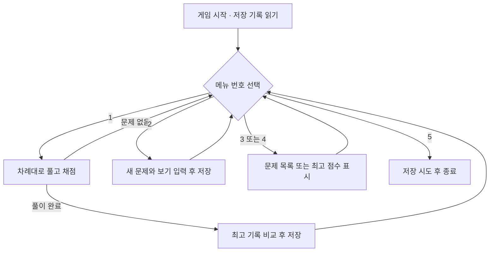
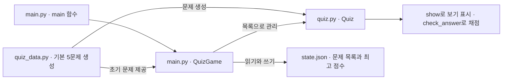
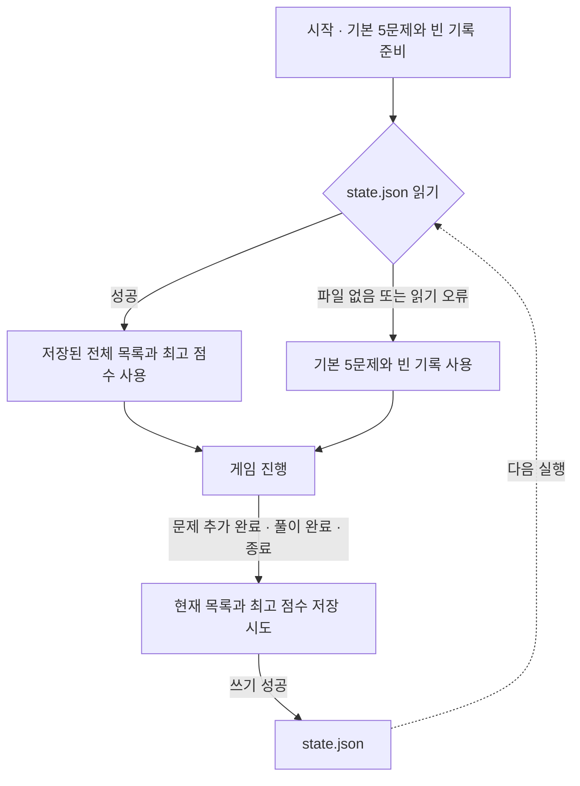
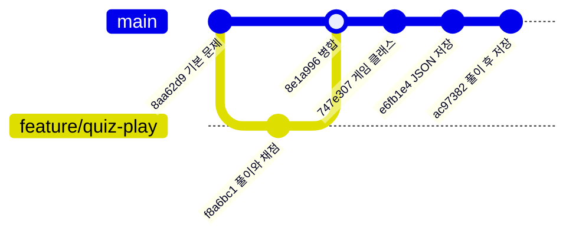

# GN_Codyssey_1-2 | Python 퀴즈 게임

> **코디세이 입학연수 · E1-2 미션**  
> 터미널에서 보기 번호를 입력해 문제를 풀고, 직접 만든 문제를 다음 게임에 다시 사용할 수 있습니다.

**퀴즈 주제는 컴퓨터공학 기초입니다.** 컴퓨터가 명령을 처리하는 방식(CPU), 전원을 끄면 사라지는 기억장치(RAM), Python 리스트, 2진수, 웹 오류 코드(HTTP 404)를 한 문제씩 풀며 기초 개념을 복습합니다. 입학연수의 기초 개념을 직접 문제로 만들고 다시 풀며 복습하기 위해 이 주제를 골랐습니다.

## 1. 실행하고 첫 화면 확인하기

개발 환경은 Ubuntu(WSL), Visual Studio Code, Python 3.10 이상입니다. 게임은 Python 표준 라이브러리만 사용합니다. Git과 Python이 설치된 터미널에서 다음 세 줄을 순서대로 실행합니다.

```bash
git clone https://github.com/Jekt-o/GN_Codyssey_1-2.git
cd GN_Codyssey_1-2
python3 main.py
```

메뉴에서 **3**을 입력하면 저장소에 담긴 **6문제**가 보입니다. 기본 5문제에 사용자가 등록한 `2+2 ?`가 포함되어 있습니다. **4**를 입력하면 함께 저장된 **최고 점수 80점**을 확인할 수 있습니다. 이 두 값은 이후 플레이에 따라 달라집니다. [배포된 저장 데이터](state.json)

## 2. 메뉴와 프로그램 실행 흐름

| 번호 | 메뉴 | 사용하면 일어나는 일 |
|---|---|---|
| 1 | 퀴즈 풀기 | 등록 순서대로 모든 문제를 풉니다. 매번 정답 여부를 알려 주고, 틀리면 정답 번호도 보여 줍니다. |
| 2 | 퀴즈 추가 | 질문, 보기 네 개, 정답 번호를 입력하면 목록 끝에 문제를 추가하고 저장합니다. |
| 3 | 퀴즈 목록 | 전체 문제 수와 질문을 번호순으로 보여 줍니다. |
| 4 | 점수 확인 | 지금까지 가장 높은 점수를 보여 줍니다. 기록이 비어 있으면 첫 풀이 전임을 안내합니다. |
| 5 | 종료 | 현재 문제와 최고 점수를 파일에 저장하고 게임을 끝냅니다. |

**점수 계산**은 `맞힌 문제 수 ÷ 전체 문제 수 × 100`입니다. 6개 중 5개를 맞히면 화면에는 83점이 표시됩니다. 최고 기록을 비교하고 저장할 때는 반올림 전 값을 사용합니다.



## 3. 파일과 클래스의 역할

클래스는 같은 종류의 데이터를 다루는 설계도입니다. `Quiz` 하나에는 한 문제의 질문·보기·정답이 들어갑니다. `QuizGame` 하나는 여러 문제를 모아 한 게임을 운영합니다.



구현을 살펴보려면 게임의 시작점, 문제 한 개의 동작, 기본 문제의 내용을 차례로 열어 보세요. [게임 실행과 저장](main.py) · [문제 클래스](quiz.py) · [기본 문제 5개](quiz_data.py)

## 4. 프로그램을 껐다 켜도 기록이 남는 원리

게임이 실행되는 동안에는 문제와 점수를 메모리에 보관합니다. 다음 실행에서도 읽을 수 있도록 `main.py`와 같은 폴더의 `state.json`에 한글 UTF-8 텍스트로 기록합니다. 이렇게 실행 사이에 데이터를 유지하는 성질을 **영속성**이라고 합니다.



| 저장 항목 | 의미 | 예시 |
|---|---|---|
| `quizzes` | 등록 순서대로 담은 문제 목록 | 저장소에는 6개 |
| `question` / `choices` | 문제 하나의 질문 / 순서가 있는 보기 네 개 | CPU의 역할을 묻는 질문과 보기 |
| `answer` | 첫 번째 보기를 1로 세는 정답 번호 | CPU 문제의 정답은 2 |
| `best_score` | 지금까지 가장 높은 점수(0~100) | 저장된 값은 `80.0`, 기록이 비면 `null` |

## 5. 잘못된 입력과 파일 오류 처리

| 상황 | 사용자가 보게 되는 동작 |
|---|---|
| 빈칸, 문자, 범위 밖의 번호 입력 | 앞뒤 공백을 제거하고 다시 묻습니다. 메뉴는 1~5, 보기와 정답 번호는 1~4입니다. |
| 질문이나 보기에 공백만 입력 | 해당 항목을 다시 묻습니다. 모든 항목을 입력해야 한 문제가 등록됩니다. |
| 저장된 문제 목록이 비어 있음 | 풀이와 목록 메뉴에서 등록된 문제가 없다고 안내합니다. |
| 파일 없음 / JSON 문법 오류, 필수 항목 누락 등 | 파일이 없으면 기본 문제로 시작합니다. 읽기·형식 오류를 감지하면 오류를 알리고 기본 5문제와 빈 점수로 돌아갑니다. 이후 저장 시 이 상태가 파일에 기록됩니다. |
| 입력 중 Ctrl+C 또는 입력 종료(EOF) | 중단 안내 후 현재 상태의 저장을 시도합니다. 진행 중이던 한 판은 끝까지 풀어야 점수에 반영됩니다. |
| 쓰기 권한 등으로 저장 실패 | 화면에 `데이터 저장 실패`와 원인을 표시합니다. 이때는 다음 실행에서 변경 내용이 유지된다고 보장할 수 없습니다. |

## 6. Git 브랜치와 개발 이력

브랜치는 기능을 따로 개발하는 작업 공간이고, 병합은 그 결과를 주 작업 공간인 `main`에 합치는 과정입니다. 아래는 퀴즈 풀이 기능이 합쳐진 경로와 이후 주요 변경을 추린 그림입니다.



풀이 기능의 변경 내용과 병합 시점, 메뉴에서 풀이를 마친 뒤 저장하도록 연결한 변경을 각각 확인할 수 있습니다. [풀이 기능 커밋](https://github.com/Jekt-o/GN_Codyssey_1-2/commit/f8a6bc18ce348426684b08bbe18e7ff40371ded5) · [병합 커밋](https://github.com/Jekt-o/GN_Codyssey_1-2/commit/8e1a996b7894c19356e5ba48e2cb3e71ec1af667) · [풀이 후 저장 커밋](https://github.com/Jekt-o/GN_Codyssey_1-2/commit/ac9738262b1ad5f99398ea1abbe30cc312301837)

### 커밋 단위와 메시지 규칙

한 커밋에는 독립적으로 설명하고 확인할 수 있는 변경 하나를 담습니다. 예를 들어 문제 모델을 정의하는 작업과 파일에 저장하는 작업은 각각 커밋합니다. 메시지 형식은 `<유형>: <변경 내용 요약>`입니다. 새 기능은 `Feat`, 오류 수정은 `Fix`, 동작을 유지하는 구조 변경은 `Refactor`, 문서나 실행 증빙은 `Docs`를 사용합니다.

다음은 원격 main에 반영된 실제 작업입니다. 각 행은 `git log --oneline`에서 확인할 수 있습니다.

```text
92f41d8 Docs: 퀴즈 게임 실행 흐름과 검증·제출 증빙 정리
ac97382 Fix: 퀴즈 플레이 및 점수 저장 로직 통합
e6fb1e4 Feat: JSON 데이터 영구 저장 및 불러오기 구현
747e307 Refactor: QuizGame 클래스로 게임 관리 구조 정리
dd9ea7b Feat: vs code show_best_score 오타 수정
b5e48cf Feat: 최고 점수 확인 및 갱신 기능 구현
f69549d Feat: 사용자 퀴즈 추가 기능 완성
387396d Feat: 퀴즈 추가 및 목록 기능 구현
f8a6bc1 Feat: 퀴즈 풀기 및 점수 계산 기능 구현
8aa62d9 Feat: 컴퓨터공학 기본 퀴즈 5개 추가
5e252bc Feat: Quiz 클래스 및 정답 확인 기능 구현
5a7fbc3 Feat: 기본 메뉴 및 입력 예외 처리 구현
43d51d0 Chore: 프로젝트 초기 파일 구성
```

## 7. 테스트 결과와 제출 증빙

Python 3.12.10에서 코드 버전 `ac97382`와 저장 데이터를 임시 폴더에 복사해 실제 메뉴 입력으로 확인했습니다. 아래 순서는 같은 결과를 재현하는 방법입니다. 저장 파일을 바꾸는 복구 시험은 별도 복사본에서 진행합니다.

| 시험 | 입력과 조작 | 확인한 결과 |
|---|---|---|
| 첫 화면과 입력 검사 | 빈 입력 → 문자 → 9 → 메뉴 3, 4 | 잘못된 입력마다 재입력을 요청하고 6문제와 80점을 표시 |
| 채점과 최고 기록 | 메뉴 1에서 차례로 `2 3 3 3 4 2`를 한 줄씩 입력 | 6개 모두 정답, 최고 점수 100점 |
| 문제 추가와 재시작 | 메뉴 2에서 빈 질문과 범위 밖 정답 번호를 거쳐 유효한 문제 등록 → 종료 → 재실행 | 입력을 다시 받고, 재실행 후 7문제와 100점 유지 |
| 낮은 점수와 입력 중단 | 7문제에서 오답을 포함해 완주 / 별도 실행에서 메뉴 입력을 EOF로 종료 | 오답 안내 후 기존 100점 유지 / 중단 안내 후 종료 |
| 저장 파일 누락과 손상 | 복사본에서 파일을 지운 경우와 파일 내용이 `{` 하나인 경우를 각각 실행 | 두 경우 모두 기본 5문제와 빈 최고 기록으로 시작 |

### 제출 전 체크리스트

- [x] 기본 5문제, 사용자 문제 추가, 목록 조회, 채점, 최고 기록 및 재시작 후 보존을 확인했다.
- [x] 메뉴 입력 오류와 저장 파일 누락·손상 시 동작을 실행으로 확인했다.
- [x] 퀴즈 풀이 기능의 개발 커밋과 병합 커밋을 위에 연결했다.
- [ ] 평가용 화면 증빙을 준비한다. 메뉴 → 문제 추가 → 목록 → 채점 → 재시작 후 목록·점수 순서로 캡처한다.
- [ ] 별도 폴더에서 `git clone` → 수정·커밋·`git push` → 원래 폴더에서 `git pull` 순으로 실습하고, 두 폴더의 마지막 커밋 ID가 같은지 기록한다.
