# GN_Codyssey_1-2 | Python 퀴즈 게임

> **코디세이 입학연수 · E1-2 미션**  
> 터미널에서 보기 번호를 입력해 문제를 풀고, 직접 만든 문제를 다음 게임에 다시 사용할 수 있습니다.

**컴퓨터공학 기초 퀴즈 5문제**로 시작하는 콘솔 게임입니다. 입학연수에서 배운 개념을 문제로 만들어 복습하기 위해 이 주제를 골랐습니다. 기본 문제는 CPU, RAM, Python 리스트, 2진수, HTTP 404를 하나씩 다룹니다.

## 1. 실행하고 첫 화면 확인하기

개발 환경은 Ubuntu(WSL), Visual Studio Code, Python 3.10 이상입니다. 게임은 Python 표준 라이브러리만 사용합니다. Git과 Python이 설치된 터미널에서 다음 세 줄을 순서대로 실행합니다.

```bash
git clone https://github.com/Jekt-o/GN_Codyssey_1-2.git
cd GN_Codyssey_1-2
python3 main.py
```

메뉴에서 **3**을 입력하면 저장소에 담긴 **6문제**가 보입니다. 기본 5문제에 사용자가 등록한 `2+2 ?`가 포함되어 있습니다. **4**를 입력하면 함께 저장된 **최고 점수 80점**을 확인할 수 있습니다. 이 두 값은 이후 플레이에 따라 달라집니다. [배포된 저장 데이터](state.json)

## 2. 메뉴와 프로그램 실행 흐름

| 번호 | 메뉴 | 입력 예시와 동작 |
|---|---|---|
| 1 | 퀴즈 풀기 | 첫 CPU 문제에서 `2`를 입력하면 ‘정답입니다!’가 표시됩니다. 틀리면 정답 번호를 알려 줍니다. 모든 문제를 풀면 정답 수와 점수를 보여 줍니다. |
| 2 | 퀴즈 추가 | 예를 들어 질문을 ‘1바이트는 몇 비트인가?’, 보기를 차례로 ‘2’, ‘4’, ‘8’, ‘16’, 정답 번호를 `3`으로 입력하면 문제를 추가하고 저장합니다. |
| 3 | 퀴즈 목록 | 배포 상태에서 `3`을 선택하면 질문 6개가 등록 순서대로 표시됩니다. 위 예시를 한 번 추가한 뒤에는 7번째 줄에 새 질문이 보입니다. |
| 4 | 점수 확인 | 배포 상태에서 `4`를 선택하면 ‘최고 점수: 80점’이 표시됩니다. 기록이 비어 있으면 첫 풀이 전임을 안내합니다. |
| 5 | 종료 | `5`를 선택하면 터미널에 `종료 사유: 메뉴에서 종료 선택`을 표시합니다. 바로 다음 줄에서 마지막 저장 시각과 성공·실패를 확인할 수 있습니다. |

**점수 계산**은 `맞힌 문제 수 ÷ 전체 문제 수 × 100`입니다. 6개 중 5개를 맞히면 화면에는 83점이 표시됩니다. 최고 기록을 비교하고 저장할 때는 반올림 전 값을 사용합니다.

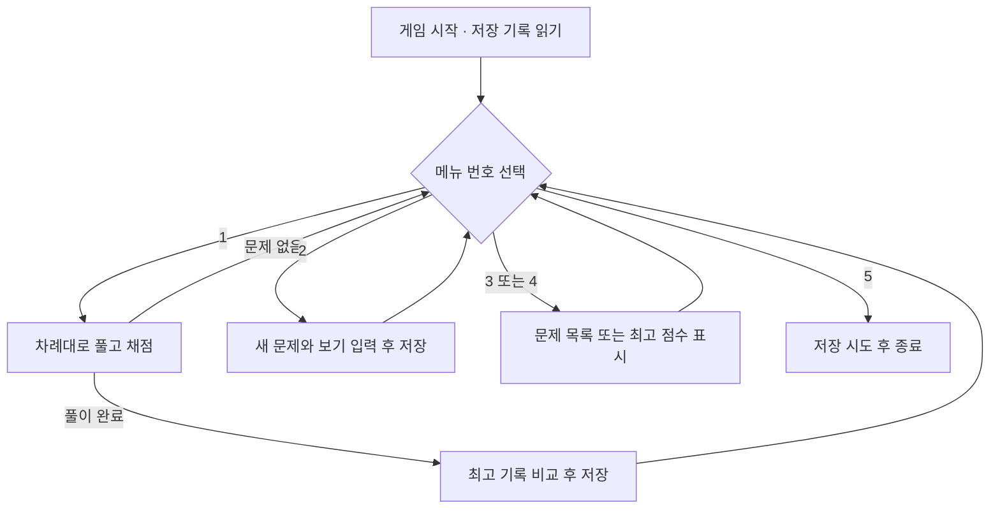

## 3. 파일과 클래스의 역할

클래스는 같은 종류의 데이터를 다루는 설계도입니다. `Quiz` 하나에는 한 문제의 질문·보기·정답이 들어갑니다. `QuizGame` 하나는 여러 문제를 모아 한 게임을 운영합니다.

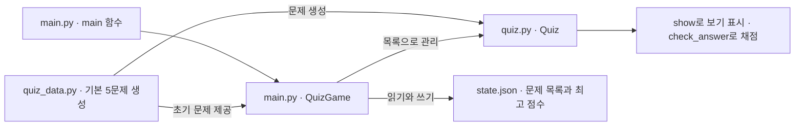

구현을 살펴보려면 게임의 시작점, 문제 한 개의 동작, 기본 문제의 내용을 차례로 열어 보세요. [게임 실행과 저장](main.py) · [문제 클래스](quiz.py) · [기본 문제 5개](quiz_data.py)

| 함수·메서드 | 맡은 일 |
|---|---|
| `get_number()` | 메뉴와 정답 입력에 공통으로 쓰입니다. 공백을 제거하고 정수 변환과 범위 검사를 통과한 값만 반환합니다. |
| `Quiz.show()`, `Quiz.check_answer()` | 한 문제의 질문과 보기를 표시하고, 사용자가 고른 번호가 정답과 같은지 판정합니다. |
| `play_quiz()` | 문제를 순서대로 출제하고 정답 수로 한 판의 점수를 계산합니다. 점수 계산식을 바꾸려면 이 함수를 수정합니다. |
| `QuizGame.play()` | 한 판의 점수를 최고 기록과 비교한 뒤 저장합니다. 최고 기록 갱신 조건은 여기에서 관리합니다. |
| `QuizGame.load_state()`, `QuizGame.save_state()` | 시작할 때 파일에서 문제와 점수를 읽고, 문제 추가·풀이 완료·종료 시점에 저장을 시도합니다. |

예를 들어 CPU 문제 객체에서 `check_answer(2)`를 호출하면 `True`가 반환됩니다. 같은 문제를 버튼으로 푸는 화면을 만든다면 버튼이 선택한 번호를 이 메서드에 전달해 채점 코드를 재사용할 수 있습니다.

## 4. 프로그램을 껐다 켜도 기록이 남는 원리

게임이 실행되는 동안에는 문제와 점수를 메모리에 보관합니다. 다음 실행에서도 읽을 수 있도록 `main.py`와 같은 폴더의 `state.json`에 한글 UTF-8 텍스트로 기록합니다. 이렇게 실행 사이에 데이터를 유지하는 성질을 **영속성**이라고 합니다.

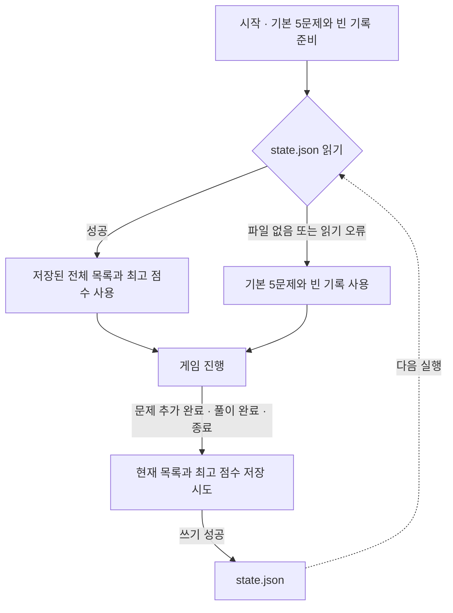

| 저장 항목 | 의미 | 예시 |
|---|---|---|
| `quizzes` | 등록 순서대로 담은 문제 목록 | 저장소에는 6개 |
| `question` / `choices` | 문제 하나의 질문 / 순서가 있는 보기 네 개 | CPU의 역할을 묻는 질문과 보기 |
| `answer` | 첫 번째 보기를 1로 세는 정답 번호 | CPU 문제의 정답은 2 |
| `best_score` | 지금까지 가장 높은 점수(0~100) | 저장된 값은 `80.0`, 기록이 비면 `null` |

JSON 배열은 문제와 보기의 순서를 보존하고, 객체의 필드 이름은 질문·보기·정답을 구분합니다. 아래는 배포 파일의 첫 문제만 남겨 구조를 보여 주는 예시입니다. `answer`가 2이므로 두 번째 보기 ‘명령어 처리’가 정답입니다.

```json
{
  "quizzes": [
    {
      "question": "CPU의 주요 역할은 무엇인가?",
      "choices": ["데이터 영구 저장", "명령어 처리", "화면 출력", "네트워크 연결"],
      "answer": 2
    }
  ],
  "best_score": 80.0
}
```

저장 결과는 터미널에 실행 환경의 현지 시각과 함께 표시됩니다. 예를 들어 저장에 성공하면 `[2026-11-09 16:05:02] 데이터가 저장되었습니다.`처럼 출력되며, 실패하면 같은 형식의 시각 뒤에 `데이터 저장 실패`와 오류 원인이 표시됩니다.

### 이전 퀴즈와 점수 복원하기

파일 내용이 바뀔 때 게임은 기존 `state.json`의 UTF-8·JSON 구조와 문제·점수 필드를 검사합니다. 유효하면 그 시점의 파일을 같은 폴더의 `state.json.bak`에 자동으로 보관한 뒤 새 상태를 저장합니다. 백업과 본 파일은 각각 같은 폴더에 임시 파일을 완성한 뒤 교체합니다. 기존 파일이 손상됐으면 이전 백업을 보존합니다. 내용이 같으면 백업도 그대로 유지합니다. 첫 저장에는 이전 상태가 없어 백업이 생기지 않을 수 있습니다. 백업 한 개에는 직전 정상 상태만 남습니다.

복원하려면 게임을 종료한 뒤 프로젝트 폴더에서 다음 명령을 실행합니다(Ubuntu/WSL). 백업이 존재하고 검사에 성공해야 복원을 진행합니다. 사용 중인 파일이 있다면 먼저 별도 이름으로 보관합니다.

```bash
python3 - <<'PY'
from datetime import datetime
from pathlib import Path
from main import decode_state, write_atomic

state = Path("state.json")
backup = Path("state.json.bak").read_bytes()
quizzes, best_score = decode_state(backup)
if state.exists():
    damaged = Path("state.json.damaged-" + datetime.now().strftime("%Y%m%d-%H%M%S-%f"))
    write_atomic(damaged, state.read_bytes())
write_atomic(state, backup)
print("복원한 문제 수:", len(quizzes), "최고 점수:", best_score)
PY
python3 main.py
```

메뉴 3과 4에서 복원한 문제와 최고 점수를 확인합니다. 쓰기 권한 오류가 표시되면 변경 내용은 아직 메모리에만 있을 수 있습니다. 게임을 열어 둔 채 다른 터미널에서 프로젝트 폴더의 쓰기 권한과 남은 공간을 확인하고 문제를 해결한 뒤 메뉴 5로 저장을 다시 시도합니다. 백업도 없으면 사용자 문제와 점수를 되살릴 자료가 없으므로 기본 5문제로 시작합니다.

**복원 시험**에서 6문제·80점으로 시작해 한 문제를 추가하고 7문제를 모두 맞혀 100점을 기록했습니다. 직전 백업은 7문제·80점이었습니다. 시험용 본 파일을 손상시켜 기본값으로 시작하고 종료한 뒤에도 백업 바이트는 그대로였습니다. 백업 복원 후 다시 실행해 목록 7개와 최고 점수 80점을 확인했습니다.

### 문제가 1,000개로 늘어나면

배포된 6문제를 반복해 1,000개로 만든 UTF-8 JSON 파일은 258,238바이트였습니다. Windows·Python 3.12.10의 로컬 복사본에서 파일 읽기, JSON 해석, 필드 검증, `Quiz` 객체 생성까지 21회 반복한 중앙값은 **1.41ms**였습니다. 별도 1회 실행에서 `tracemalloc`으로 측정한 이 구간의 Python 메모리 할당 최고치는 **1.17MiB**였습니다. 반복 읽기라 운영체제 캐시가 영향을 줄 수 있으며, 터미널 출력·사용자 입력·저장 시간은 측정에서 제외했습니다.

| 작업 | 현재 비용과 개선 조건 |
|---|---|
| 시작·저장 | 전체 파일 크기에 비례해 읽고 직렬화합니다. 변경 저장은 이전 상태 검증과 백업까지 수행합니다. 작은 변경을 자주 저장할 때는 SQLite에서 변경 행만 트랜잭션으로 갱신할 수 있습니다. |
| 메모리 | 로딩 중 원본 바이트, JSON 자료, 퀴즈 객체가 메모리를 사용합니다. 긴 질문과 보기가 많아지면 같은 문제 수라도 메모리 사용량이 커집니다. |
| 목록·검색 | 전체 목록 출력은 문제 수만큼 출력해야 하므로 페이지 단위 표시가 유용합니다. 현재 검색 메뉴는 없습니다. 주제 검색을 추가하면 단순 순회는 최악에 모든 문제를 확인합니다. 반복적인 주제별 조회에는 SQLite의 주제 열 인덱스를 고려할 수 있습니다. |

## 5. 잘못된 입력과 파일 오류 처리

| 상황 | 사용자가 보게 되는 동작 |
|---|---|
| 빈칸, 문자, 범위 밖의 번호 입력 | 입력 앞뒤의 공백을 제거한 뒤 검사합니다. 잘못 입력하면 이유와 허용 범위(메뉴 1~5, 정답 번호 1~4)를 표시하고 다시 묻습니다. |
| 질문이나 보기에 공백만 입력 | 해당 항목을 다시 묻습니다. 모든 항목을 입력해야 한 문제가 등록됩니다. |
| 저장된 문제 목록이 비어 있음 | 풀이와 목록 메뉴에서 등록된 문제가 없다고 안내합니다. |
| 파일 없음 / JSON 문법 오류, 필수 항목 누락 등 | 파일이 없으면 기본 문제로 시작합니다. 읽기·형식 오류를 감지하면 오류를 알리고 기본 5문제와 빈 점수로 돌아갑니다. 이후 저장 시 이 상태가 파일에 기록됩니다. |
| 입력 중 Ctrl+C 또는 입력 종료(EOF) | 터미널에 현지 시각과 종료 사유(`Ctrl+C 입력` 또는 `입력 스트림 종료(EOF)`)를 표시하고 현재 상태의 저장을 시도합니다. 진행 중이던 한 판은 끝까지 풀어야 점수에 반영됩니다. |
| 쓰기 권한 등으로 저장 실패 | 화면에 `데이터 저장 실패`와 원인을 표시합니다. 이때는 다음 실행에서 변경 내용이 유지된다고 보장할 수 없습니다. |

## 6. Git 브랜치와 개발 이력

브랜치는 기능을 따로 개발하는 작업 공간이고, 병합은 그 결과를 주 작업 공간인 `main`에 합치는 과정입니다. 아래는 퀴즈 풀이 기능이 합쳐진 경로와 이후 주요 변경을 추린 그림입니다.

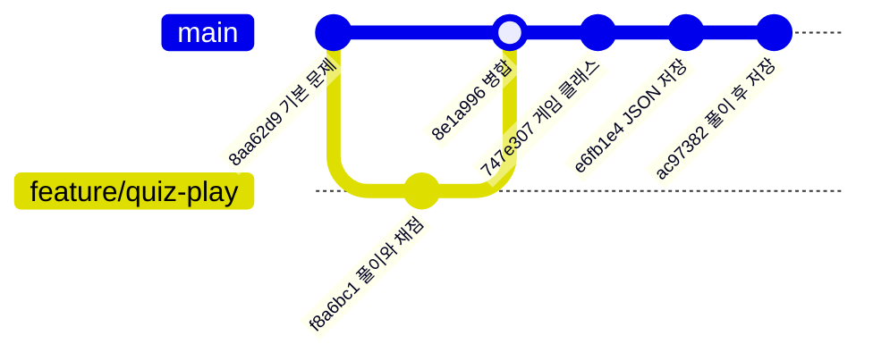

풀이 기능의 변경 내용과 병합 시점, 메뉴에서 풀이를 마친 뒤 저장하도록 연결한 변경을 각각 확인할 수 있습니다. [풀이 기능 커밋](https://github.com/Jekt-o/GN_Codyssey_1-2/commit/f8a6bc18ce348426684b08bbe18e7ff40371ded5) · [병합 커밋](https://github.com/Jekt-o/GN_Codyssey_1-2/commit/8e1a996b7894c19356e5ba48e2cb3e71ec1af667) · [풀이 후 저장 커밋](https://github.com/Jekt-o/GN_Codyssey_1-2/commit/ac9738262b1ad5f99398ea1abbe30cc312301837)

### 커밋 단위와 메시지 규칙

한 커밋에는 독립적으로 설명하고 확인할 수 있는 변경 하나를 담습니다. 예를 들어 문제 모델을 정의하는 작업과 파일에 저장하는 작업은 각각 커밋합니다. 메시지 형식은 `<유형>: <변경 내용 요약>`입니다. 새 기능은 `Feat`, 오류 수정은 `Fix`, 동작을 유지하는 구조 변경은 `Refactor`, 문서나 실행 증빙은 `Docs`를 사용합니다.

다음은 원격 main에 반영된 실제 작업입니다. 각 행은 `git log --oneline`에서 확인할 수 있습니다.

```text
92f41d8 Docs: 퀴즈 게임 실행 흐름과 검증·제출 증빙 정리
ac97382 Fix: 퀴즈 플레이 및 점수 저장 로직 통합
e6fb1e4 Feat: JSON 데이터 영구 저장 및 불러오기 구현
747e307 Refactor: QuizGame 클래스로 게임 관리 구조 정리
dd9ea7b Feat: vs code show_best_score 오타 수정
b5e48cf Feat: 최고 점수 확인 및 갱신 기능 구현
f69549d Feat: 사용자 퀴즈 추가 기능 완성
387396d Feat: 퀴즈 추가 및 목록 기능 구현
f8a6bc1 Feat: 퀴즈 풀기 및 점수 계산 기능 구현
8aa62d9 Feat: 컴퓨터공학 기본 퀴즈 5개 추가
5e252bc Feat: Quiz 클래스 및 정답 확인 기능 구현
5a7fbc3 Feat: 기본 메뉴 및 입력 예외 처리 구현
43d51d0 Chore: 프로젝트 초기 파일 구성
```

## 7. 테스트 결과와 제출 증빙

Python 3.12.10에서 코드 버전 `ac97382`와 저장 데이터를 임시 폴더에 복사해 실제 메뉴 입력으로 확인했습니다. 아래 순서는 같은 결과를 재현하는 방법입니다. 저장 파일을 바꾸는 복구 시험은 별도 복사본에서 진행합니다.

| 시험 | 입력과 조작 | 확인한 결과 |
|---|---|---|
| 첫 화면과 입력 검사 | 빈 입력 → 문자 → 9 → 메뉴 3, 4 | 잘못된 입력마다 재입력을 요청하고 6문제와 80점을 표시 |
| 채점과 최고 기록 | 메뉴 1에서 차례로 `2 3 3 3 4 2`를 한 줄씩 입력 | 6개 모두 정답, 최고 점수 100점 |
| 문제 추가와 재시작 | 메뉴 2에서 빈 질문과 범위 밖 정답 번호를 거쳐 유효한 문제 등록 → 종료 → 재실행 | 입력을 다시 받고, 재실행 후 7문제와 100점 유지 |
| 낮은 점수와 입력 중단 | 7문제에서 오답을 포함해 완주 / 별도 실행에서 메뉴 입력을 EOF로 종료 | 오답 안내 후 기존 100점 유지 / 중단 안내 후 종료 |
| 저장 파일 누락과 손상 | 복사본에서 파일을 지운 경우와 파일 내용이 `{` 하나인 경우를 각각 실행 | 두 경우 모두 기본 5문제와 빈 최고 기록으로 시작 |

### 제출 전 체크리스트

- [x] 기본 5문제, 사용자 문제 추가, 목록 조회, 채점, 최고 기록 및 재시작 후 보존을 확인했다.
- [x] 메뉴 입력 오류와 저장 파일 누락·손상 시 동작을 실행으로 확인했다.
- [x] 퀴즈 풀이 기능의 개발 커밋과 병합 커밋을 위에 연결했다.
- [x] 아래에 검증 환경, 실제 게임 실행, Git 그래프와 복제 실습 출력을 첨부했다.

### 실행 화면과 Git 실습 기록

다음 PNG는 2026-11-09 Windows 검증 콘솔의 **실제 화면 버퍼 문자 출력을 읽어 이미지로 렌더링한 자료**입니다. 게임 화면은 배포 데이터를 복사한 폴더에서 게임 메서드에 예시 입력을 전달해 얻었습니다. 메뉴 2에서 7번째 문제를 추가하고 모두 맞힌 뒤 새 게임 객체가 파일을 읽어 7문제·100점을 표시하는 순서입니다.

| 검증 환경 | 메뉴 | 문제 추가 |
|---|---|---|
| 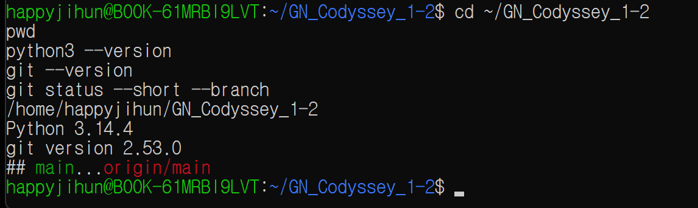 | 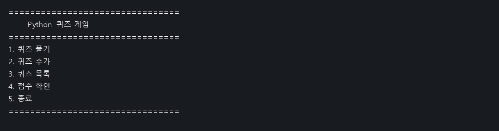 | 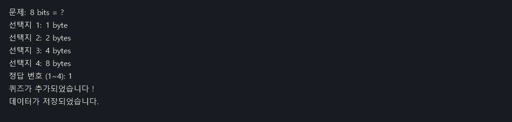 |

| 목록 | 플레이와 채점 | 저장 데이터 다시 읽기 |
|---|---|---|
| 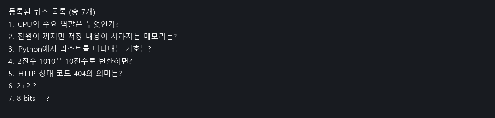 | 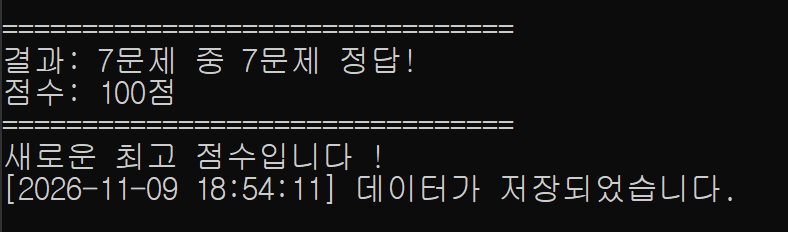 | 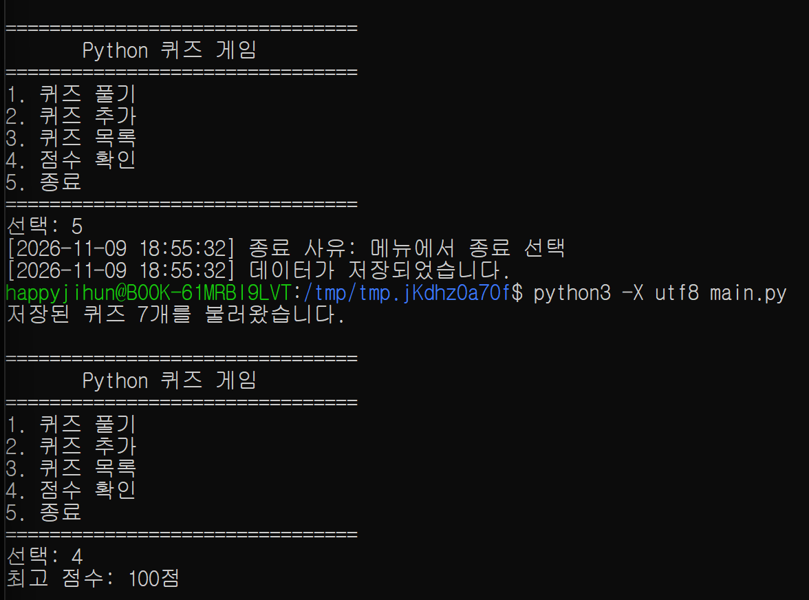 |

기능 개발 당시의 실제 `git log --oneline --graph 92f41d8` 출력입니다.

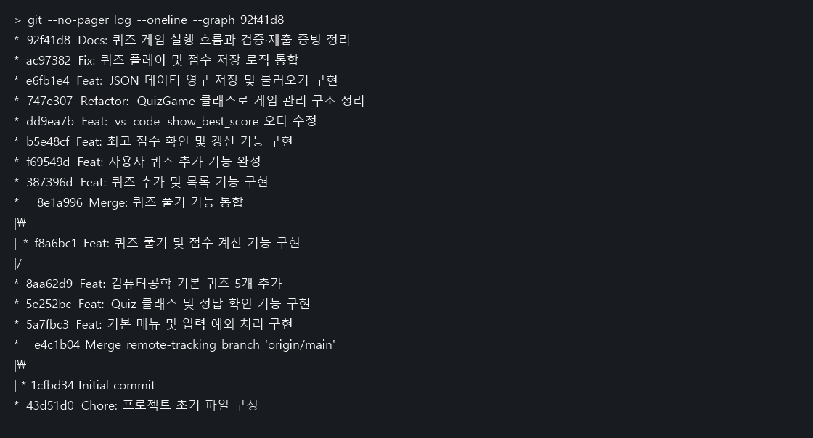

**복제와 동기화 실습.** Windows의 별도 폴더에 원격 저장소를 clone한 시점은 `92f41d8`입니다. 이 복제본에서 주제 선정 이유·커밋 규칙을 README에 작성하고 `9cb5c63`으로 commit한 뒤 GitHub main에 push했습니다. 기존 WSL 개발 폴더에는 커밋하지 않은 변경이 있어, 같은 저장소에 연결된 별도 worktree(`/tmp/quiz-pull-20261109`)에서 `git pull --ff-only origin main`을 수행했습니다. 해당 작업 트리는 `ac97382`에서 `9cb5c63`으로 fast-forward했고, README에 새 절 ‘커밋 단위와 메시지 규칙’이 생긴 것을 확인했습니다. 동기화 직후 양쪽의 `git rev-parse HEAD` 결과는 **`9cb5c639c83ae102e873cdee848d89373b6da2bb`**였습니다.

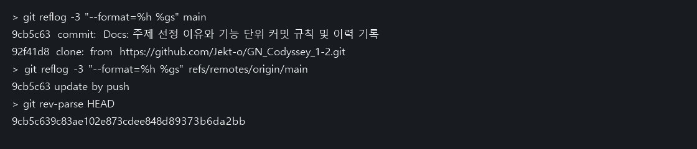

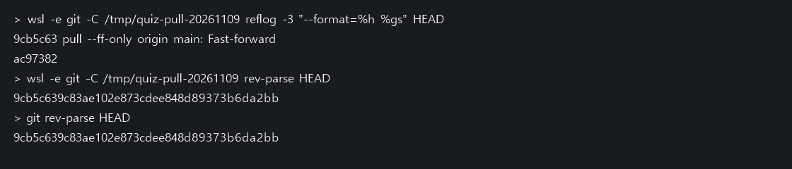
